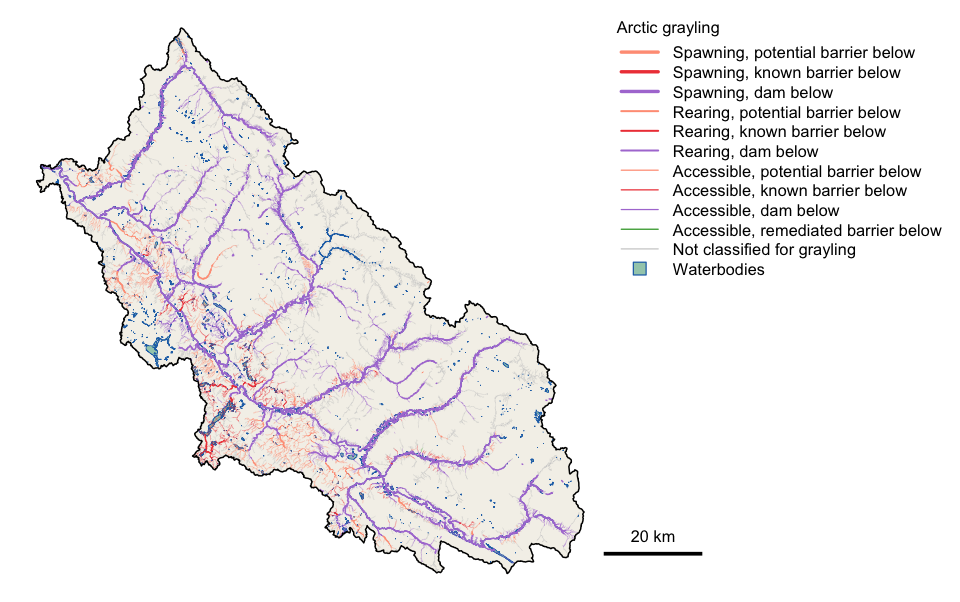

# link 

> Intrinsic habitat potential and fish passage connectivity for stream networks

link models where fish habitat could be on a stream network and whether fish can reach it. For each species it classifies stream, lake and wetland reaches as spawning or rearing habitat from gradient and channel width or discharge, then resolves access past road crossings, dams, falls and steep gradients, using fish observations and habitat confirmations as evidence of passage. The result tells a restoration program which crossings stand between fish and habitat, how much spawning and rearing habitat sits above each one, and what a fix would open up. It runs on the British Columbia Freshwater Atlas through [fresh](https://github.com/NewGraphEnvironment/fresh).

> Experimental: APIs and outputs change without notice.



*Arctic grayling in the Parsnip River watershed group, from link's `default` config. Every reach drains to Williston Reservoir behind the W.A.C. Bennett Dam, so most carry "dam below" (purple). Orange and red reaches sit above a road crossing modelled or assessed as a barrier: these are the crossings whose repair would reconnect habitat. Made by `data-raw/readme_figure.R` from the vignette's cached data.*

## Installation

```r
pak::pak("NewGraphEnvironment/link")
```

## Setup

link reads and writes a PostgreSQL database holding the Freshwater Atlas through [fwapg](https://github.com/smnorris/fwapg), the same setup fresh uses (see fresh's `docker/` for a local one). `lnk_db_conn()` connects from the `PG_*_SHARE` environment variables, falling back to the standard `PG*` ones.

## Example

Model one watershed group under link's `default` config, then read back kilometres of accessible, spawning and rearing habitat per species. Not run here: it needs the database above.

```r
library(link)

conn   <- lnk_db_conn()
cfg    <- lnk_config("default")
cfg$pipeline$schema <- "fresh_default"   # where this config's results persist
loaded <- lnk_load_overrides(cfg)

lnk_pipeline_run(conn, aoi = "PARS", cfg = cfg, loaded = loaded,
                 mapping_code = TRUE)

lnk_rollup_wsg(conn, aoi = "PARS", species = c("BT", "GR"),
               schema = "fresh_default")
```

## What it does

**Intrinsic habitat potential.** Each species' spawning and rearing rules come from gradient, channel width or mean annual discharge, and the size of lakes and wetlands. Rearing is reported separately for streams, lakes and wetlands, and in `default` lake and wetland rearing counts only where it connects to the same species' spawning (sockeye and kokanee excepted). `default_tuned` also fills discharge gaps on the main stems of large rivers from the nearest valued reach on the same river. `lnk_pipeline_run()` runs the whole sequence for a watershed group; each phase is its own `lnk_pipeline_*()` call, so a run can be stopped, inspected and resumed.

**Connectivity.** Access is resolved per species, so a barrier blocks only the species it should: a 15 % gradient stops salmon but not bull trout. Fish observations and habitat confirmations upstream lift a barrier where they show fish get past it (`lnk_barrier_overrides()`). Crossings from different inventories are matched by network position (`lnk_match()`). For each crossing, `lnk_aggregate()` sums the habitat upstream of it, and `lnk_mapping_code()` gives every segment a code for habitat and the barrier type below it, ready to style in QGIS.

**Rules kept as data.** Thresholds, rules, species and the observations that count as evidence for each species are CSVs in a config bundle, each with a data dictionary (`lnk_config()`). `default` holds link's biological defaults and `default_tuned` values being calibrated against fish observations. Both model rainbow trout, kokanee and Arctic grayling alongside salmon, steelhead, bull trout and westslope cutthroat trout. Most method changes are a reviewed row edit, not a code change.

**Checked against fish.** `lnk_habitat_validate()` scores a run against fish observations: how many land on habitat the model calls accessible, spawning or rearing, what that costs in kilometres, and why each miss was missed. `lnk_habitat_validate_band()` scores a threshold change on the reaches it moves. `lnk_species_pooling()` resolves which observation species count as evidence for which model species, region by region.

**Provenance and export.** Each run records its inputs, its parameters and the source versions its data was loaded from, in log tables beside its results (`lnk_log_read()`, `lnk_artifact_record()`). `lnk_scenario_export()` writes results per config and species as Parquet with a manifest, which `lnk_catalog()` reads and `lnk_db_load()` loads into another database.

## Documentation

- [Reference](https://newgraphenvironment.github.io/link/reference/): every exported function, grouped by name.
- [Bull trout and Arctic grayling in the Parsnip River](https://newgraphenvironment.github.io/link/articles/pars-habitat-connectivity.html): a full run for one watershed group, its maps for both species, and how its numbers compare with the reference model's.

## Ecosystem

| Package | Role |
|---|---|
| **link** | Intrinsic habitat potential and fish passage connectivity, per species (this package) |
| [fresh](https://github.com/NewGraphEnvironment/fresh) | Stream network modelling engine: segment, classify, cluster, aggregate |
| [wet](https://github.com/NewGraphEnvironment/wet) | Stream flow and water temperature for BC's Freshwater Atlas |
| [crate](https://github.com/NewGraphEnvironment/crate) | Canonical schemas and validation for input data |
| [gq](https://github.com/NewGraphEnvironment/gq) | Shared map symbology, used for the habitat and access codes |

Discharge comes from fwapg's modelled table today. wet's per-segment flow is not yet read ([#331](https://github.com/NewGraphEnvironment/link/issues/331)).

## Data and methods it builds on

link's connectivity model follows the method of [bcfishpass](https://github.com/smnorris/bcfishpass), built by Simon Norris and maintained with contributions from many groups. Every link config reads bcfishpass's community-maintained correction data: crossing structure fixes, PSCIS barrier status, PSCIS-to-modelled crossing matches, definite barriers and their controls, habitat confirmations and other crossings. These are synced from bcfishpass weekly, with the upstream commit and checksums recorded, so corrections stay in one place. The `bcfishpass` config applies bcfishpass's own rules and thresholds, so link's results can be checked against the method they come from. Fish observations come from [bcfishobs](https://github.com/smnorris/bcfishobs), and the stream network from [fwapg](https://github.com/smnorris/fwapg) and the [BC Freshwater Atlas](https://www2.gov.bc.ca/gov/content/data/geographic-data-services/topographic-data/freshwater).

## Citation

```r
citation("link")
```

Citation metadata is in [`CITATION.cff`](CITATION.cff).

## License

MIT (see [`LICENSE`](LICENSE)). Redistributed bcfishpass data carries its own license: see [`NOTICE.md`](NOTICE.md) and [`LICENSE-bcfishpass`](LICENSE-bcfishpass).
